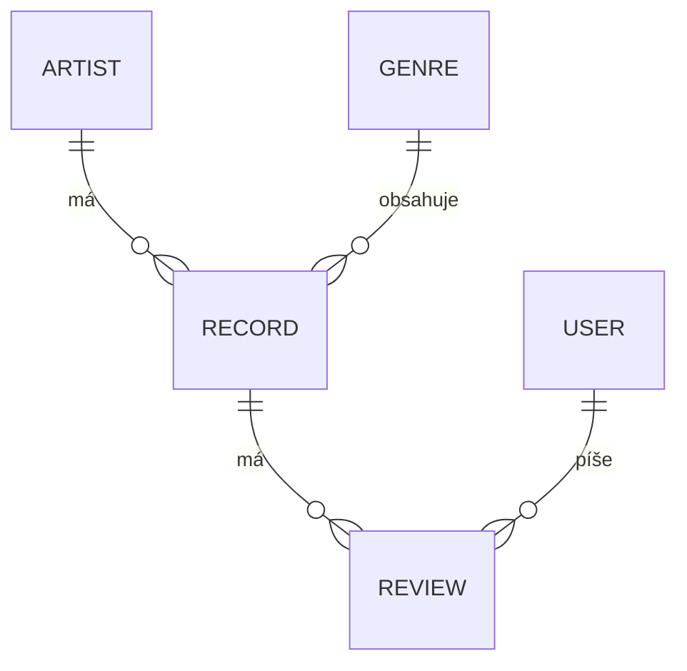

# 33 RPM

Meno a priezvisko študenta

Študijná skupina

## Stručný opis projektu
**33 RPM** je webová aplikácia pre milovníkov vinylových platní. Slúži ako online katalóg, v ktorom si návštevníci môžu prezerať platne, vyhľadávať ich podľa názvu alebo interpreta a filtrovať podľa hudobného žánru. Pri každej platni nájdu obal, rok vydania, popis a hodnotenia od ostatných používateľov.

Aplikácia rieši problém roztrúsených informácií o vinylových platniach – na jednom mieste spája katalóg platní, informácie o interpretoch a recenzie komunity. Je určená zberateľom vinylov a ľuďom, ktorí hľadajú inšpiráciu, čo si vypočuť alebo kúpiť. Registrovaní používatelia môžu platne hodnotiť a písať recenzie, správca sa stará o obsah katalógu.

## Role v projekte
- **Návštevník (neprihlásený)** – môže prezerať katalóg platní, detail platne, zoznam interpretov a čítať recenzie. Nemôže pridávať žiadny obsah.
- **Registrovaný používateľ** – má všetky oprávnenia návštevníka a navyše môže písať recenzie s hodnotením (1–5), upravovať a mazať **iba svoje vlastné** recenzie.
- **Správca (admin)** – zodpovedá za obsah katalógu. Môže pridávať, upravovať a mazať platne, interpretov a žánre, nahrávať obaly platní a fotografie interpretov a mazať akúkoľvek recenziu (napr. nevhodnú).

## Prípady použitia podľa rolí

**Návštevník**
- návštevník si prezrie zoznam najnovších a najlepšie hodnotených platní na úvodnej stránke,
- návštevník vyhľadá platňu podľa názvu alebo interpreta,
- návštevník vyfiltruje platne podľa žánru (bez obnovenia stránky),
- návštevník si zobrazí detail platne s recenziami,
- návštevník si zobrazí profil interpreta so všetkými jeho platňami,
- návštevník sa zaregistruje / prihlási.

**Registrovaný používateľ**
- používateľ pridá recenziu a hodnotenie k platni (bez obnovenia stránky),
- používateľ upraví svoju recenziu,
- používateľ zmaže svoju recenziu,
- používateľ sa odhlási.

**Správca**
- správca pridá novú platňu a nahrá jej obal,
- správca upraví údaje platne alebo vymení obal,
- správca zmaže platňu (spolu s jej obalom zo servera),
- správca pridá, upraví a zmaže interpreta (vrátane fotografie),
- správca pridá, upraví a zmaže žáner,
- správca zmaže nevhodnú recenziu ľubovoľného používateľa.

## Plánované entity

**Používateľ (User)** – uchováva účty používateľov aplikácie. Obsahuje používateľské meno, e-mail, zahashované heslo a rolu (používateľ alebo správca). Používateľ môže napísať viacero recenzií.

**Interpret (Artist)** – predstavuje interpreta alebo kapelu. Obsahuje meno, krajinu, krátky životopis a fotografiu. Interpret môže mať viacero platní.

**Žáner (Genre)** – hudobný žáner, napríklad rock, jazz alebo hip-hop. Obsahuje názov žánru. Do jedného žánru patrí viacero platní.

**Platňa (Record)** – hlavná entita aplikácie, vinylová platňa v katalógu. Obsahuje názov, rok vydania, popis a obal platne. Každá platňa patrí jednému interpretovi a jednému žánru a môže mať viacero recenzií.

**Recenzia (Review)** – hodnotenie platne od používateľa. Obsahuje hodnotenie od 1 do 5, text recenzie a dátum vytvorenia. Každá recenzia patrí jednej platni a jednému používateľovi.

Rola používateľa je uložená ako stĺpec v tabuľke používateľov (nie samostatné tabuľky pre každú rolu). Obrázky sa ukladajú na disk servera a v databáze je uložená iba cesta k súboru.

## Vzťahy medzi entitami
- **Artist 1 : N Record** – jeden interpret môže mať viac platní, každá platňa patrí práve jednému interpretovi.
- **Genre 1 : N Record** – jeden žáner obsahuje viac platní, každá platňa má jeden žáner.
- **Record 1 : N Review** – k jednej platni môže byť viac recenzií, recenzia patrí jednej platni.
- **User 1 : N Review** – jeden používateľ môže napísať viac recenzií, každá recenzia má jedného autora.

Entita Review tak prepája používateľov a platne – v podstate realizuje vzťah **M:N medzi User a Record** (používateľ hodnotí veľa platní, platňa má hodnotenia od veľa používateľov), pričom nesie vlastné údaje (hodnotenie a text).

## Hlavné stránky aplikácie
1. **Úvodná stránka** – najnovšie pridané a najlepšie hodnotené platne.
2. **Katalóg platní** – mriežka kariet s obalmi, vyhľadávanie a filter podľa žánru (AJAX).
3. **Detail platne** – obal, informácie o platni, priemerné hodnotenie, zoznam recenzií a formulár na pridanie recenzie (AJAX).
4. **Interpreti** – zoznam interpretov.
5. **Detail interpreta** – fotografia, informácie a všetky platne daného interpreta.
6. **Administrácia platní** – tabuľka platní s tlačidlami upraviť / zmazať, formulár na pridanie a úpravu platne s nahraním obalu.
7. **Administrácia interpretov a žánrov** – správa interpretov (s fotografiou) a žánrov.
8. **Prihlásenie a registrácia** – formuláre na prihlásenie a vytvorenie účtu.

## Rozdelenie funkcionality

**Základné funkcie** (minimum na úspešné dokončenie projektu)
- registrácia, prihlásenie a odhlásenie, heslá uložené ako hash,
- dve role (používateľ, správca) a kontrola oprávnení na strane servera,
- CRUD operácie nad platňami a interpretmi (správca),
- CRUD operácie nad žánrami (správca) a recenziami (používateľ – iba svoje),
- nahrávanie obalov platní a fotografií interpretov, mazanie súborov pri zmazaní záznamu,
- AJAX filtrovanie a vyhľadávanie v katalógu,
- AJAX pridávanie recenzie bez obnovenia stránky,
- validácia vstupov na strane klienta (JavaScript) aj servera (PHP),
- ochrana proti SQL injection (prepared statements),
- responzívny dizajn,
- spustenie v Dockeri s automatickým importom ukážkových dát.

**Rozširujúce funkcie** (podľa časových možností)
- animácia otáčajúcej sa platne pri prechode myšou (CSS animácie),
- náhľad obalu pred nahraním (HTML5 File API),
- pokročilá validácia formulárov na strane klienta (okamžitá spätná väzba pri písaní),
- stránkovanie katalógu cez AJAX,
- priemerné hodnotenie platne zobrazené hviezdičkami,
- zoradenie katalógu (podľa roku, hodnotenia, názvu).

## Spustenie aplikácie
Aplikácia je postavená na frameworku [Vaííčko](https://github.com/thevajko/vaiicko).

**Pomocou Dockeru (odporúčané)**
1. V priečinku `docker` spustite príkaz `docker compose up`.
2. Aplikácia je dostupná na adrese [http://localhost/](http://localhost/).

**Bez Dockeru (vstavaný PHP server, PHP 8.3+)**
1. V koreňovom priečinku projektu spustite `php -S localhost:8000 -t public`.
2. Aplikácia je dostupná na adrese [http://localhost:8000/](http://localhost:8000/).

**Implementované stránky**
- Úvodná stránka – `?c=home`
- Detail platne – `?c=record&a=detail`
- Administrácia (po prihlásení, testovací účet `admin` / `admin`) – `?c=admin`

Statická HTML/CSS verzia z úlohy 4 je ponechaná v priečinku `html`.
